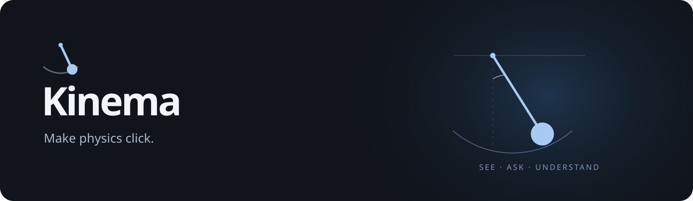
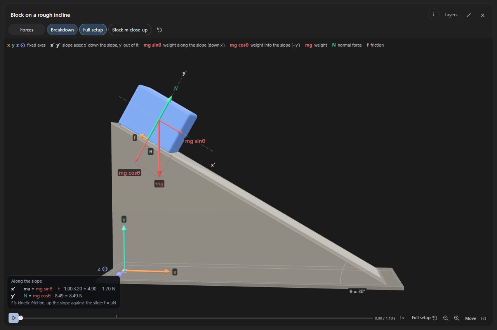
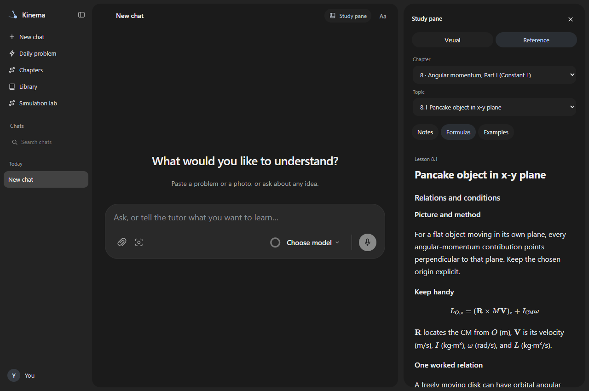

<p align="center"></p>

<p align="center">
  A quieter place to understand physics.<br>
  Interactive visuals, worked examples and a tutor beside your notes.
</p>

<p align="center">
  <a href="#get-started">Get started</a> ·
  <a href="docs/PUBLIC-SETUP.md">Setup guide</a> ·
  <a href="docs/AGENT-SETUP.md">Install on another computer</a> ·
  <a href="#what-this-preview-includes">Preview status</a> ·
  <a href="CONTRIBUTING.md">Contribute</a>
</p>

Kinema is a local study app for classical mechanics. Follow a worked example,
explore the motion, then ask about the step that doesn't make sense.
There are no streaks or points to keep up with.

## See the physics

Play a prepared simulation, move closer to the object, and reveal forces or
components when you need them. Keep the picture simple until it's time for more.



## Keep the useful things beside you

A normal conversation on the left; a resizable Study pane on the right.
Browse notes, formulas and worked examples, or keep the current visual open
while you talk through it. Choose the model from the composer.



- **Ask at your own pace.** Work through one idea or request a full explanation.
- **Bring your own problem.** Attach a question or homework image to a chat.
- **Explore before signing in.** Prepared references and reusable visuals work without AI.
- **Keep your work locally.** Each installation has its own chats, uploads and settings.

## Get started

**Early public preview · Python 3.11+ · Windows is the primary tested platform.**

Clone this repository, then create an environment:

```sh
git clone https://github.com/Diamonqq/Kinema.git
cd Kinema
python -m venv .venv
```

On **Windows**:

```powershell
.venv\Scripts\python -m pip install -r requirements.txt
.venv\Scripts\python start.py
```

On **macOS or Linux**:

```sh
.venv/bin/python -m pip install -r requirements.txt
.venv/bin/python start.py
```

Open **http://127.0.0.1:8790**. The welcome guide lets you connect an account
or choose **Explore without AI**. macOS and Linux installation paths are provided;
their complete device experience has not been verified.

### AI accounts

| Account | Official connection | Homework images |
| --- | --- | --- |
| ChatGPT | Codex | Supported |
| Claude | Claude Code | Supported |
| Kimi | Kimi Code | Text only |
| Google | Unavailable in this preview | — |

Sign in through the provider's own flow. Your account's permissions, plan and
usage limits apply. API keys are an optional advanced connection and can carry
separate charges. [Connection details →](docs/PROVIDERS.md)

### Your data

Chats, uploads and settings are saved on your computer. AI requests send the
relevant question and context to the account you select. Kinema does not provide
its own hosted AI service. Keep the server on localhost; this is a single-user app.
See [data locations and launch options](docs/PUBLIC-SETUP.md#your-data).

## What this preview includes

This is a starting point for a visual study app, with prepared mechanics
references, reusable simulations, normal chat and a guided account setup.

**The public repository excludes imported textbooks, numbered textbook question
and solution packs, course assessments and anyone's saved study history.**
Upload your own question to work with it. Daily's timed problem flow needs a
separately prepared local problem pack and is unavailable without one.
The larger development installation's textbook coverage is not included here.

Prepared simulations cover specific supported setups. Generated visuals and AI
explanations can need correction; arbitrary 3D assemblies do not all have physical
dynamics. The screenshots show the actual public app with prepared content and
no personal account or conversation data.

## Development

Python/FastAPI serves the app; the interface is browser JavaScript.
The app's data stays separate from the checkout. Start with the
[contributing guide](CONTRIBUTING.md) for layout, isolated checks and useful bug reports.

Prepared references, formulas and Library visuals work offline after installation.
The tutor and account setup need internet access. The browser runtime is bundled
with the release. [Laptop / setup-agent instructions →](docs/AGENT-SETUP.md)

Next priorities are easier installation, clearer teaching visuals and broader
checks on real devices and provider accounts. Feedback on an actual study flow
is especially useful.

## Credits and licensing

Built by [Conner](https://github.com/Diamonqq).
Provider marks retain their original licenses; see
[third-party notices](THIRD-PARTY-NOTICES.md).
No project-wide open-source license has been selected yet.
